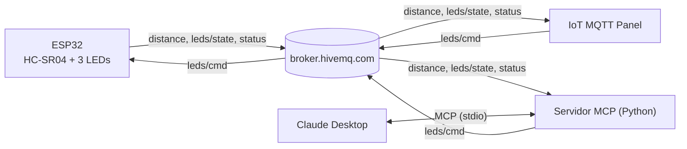

# ThirdProject-IoT — Objeto inteligente con MQTT y MCP

**Grupo 1 — SIS-234**

- Ricardo Andres Andrade Vargas
- Dabner Eliezer Orozco Veizaga

Un ESP32 con un sensor HC-SR04 y tres LEDs publica la distancia en el broker público de HiveMQ. La app IoT MQTT Panel la grafica y controla los LEDs. Un servidor MCP en Python permite hacer lo mismo desde Claude Desktop en lenguaje natural. Todos los componentes se comunican solo a través del broker.

## Arquitectura

La distancia no decide qué LED se enciende: el objeto inteligente solo mide y publica, y los LEDs solo obedecen comandos. La app y el servidor MCP son clientes MQTT equivalentes (comunicación N a N).



| Carpeta | Contenido |
|---|---|
| `src/`, `include/` | Firmware del ESP32 (PlatformIO). |
| `mcp_server/` | Servidor MCP y su configuración para Claude Desktop. |
| `app/` | Configuración y exportación del panel de IoT MQTT Panel. |
| `tools/` | Scripts que miden los requisitos no funcionales. |
| `docs/evidencias/` | Salidas de las mediciones. |

## Protocolo MQTT

Broker: `broker.hivemq.com:1883` (TCP, sin TLS ni credenciales). Las constantes están en `include/MqttConfig.h` y `mcp_server/config.py`, y coinciden.

| Tópico | Publica | Se suscribe | QoS | Retenido | Payload |
|---|---|---|---|---|---|
| `sis234/grupo1/distance` | OI | App, MCP | 0 | No | `{"seq":12,"cm":23.5}`; `{"seq":13,"cm":null}` si la lectura es inválida |
| `sis234/grupo1/leds/cmd` | App, MCP | OI | 1 | No | `{"led":"red","state":"on"}`; `led` ∈ red, yellow, white, all; `state` ∈ on, off; máx. 64 bytes |
| `sis234/grupo1/leds/state` | OI | App, MCP | 0 | Sí | `{"red":1,"yellow":0,"white":0}` tras aplicar cada comando |
| `sis234/grupo1/status` | OI (LWT) | App, MCP | 1 | Sí | `online` / `offline` |

- **`distance`, QoS 0 y sin retener:** llega una lectura nueva cada 0.4 s, así que perder una no importa y una lectura vieja no debe mostrarse como actual. `seq` crece en 1 por lectura (un hueco es una lectura perdida). `cm` lleva 1 decimal, o `null` si no hubo eco o está fuera de 2–400 cm: nunca se publica un número falso.
- **`leds/cmd`, QoS 1 y sin retener:** un comando debe llegar al menos una vez, pero no debe quedar guardado en el broker, porque el ESP32 lo volvería a ejecutar en cada reconexión.
- **`leds/state` y `status`, retenidos:** quien se conecta tarde (la app, el MCP) recibe enseguida el último estado. `status` es el *last will*: el ESP32 lo registra como `offline` al conectarse y publica `online`; si se cae, el broker publica `offline` por él.
- **QoS de publicación del ESP32:** PubSubClient solo publica con QoS 0 (limitación de la librería), por eso `leds/state` y `status = online` salen con QoS 0. El `offline` del last will lo publica el broker con QoS 1.
- **Keepalive:** 15 s en el ESP32; el broker detecta una caída en unos 22 s (1.5 × keepalive).
- **Client IDs únicos** (si dos clientes repiten el ID, el broker desconecta al anterior): OI `sis234-g1-oi-<MAC>`, MCP `sis234-g1-mcp-<pid>`, app `sis234-g1-app`, scripts `sis234-g1-tool-<nombre>`.
- **Comandos inválidos:** JSON mal formado, campos faltantes, valores desconocidos o más de 64 bytes se ignoran y quedan en el log serie como `CMD_INVALID` con el motivo.
- **Al reconectarse**, el ESP32 vuelve a suscribirse, apaga los LEDs y publica ese estado retenido. Mientras no tiene broker, los tres LEDs parpadean.

## Herramientas MCP

| Herramienta | Parámetros | Propósito |
|---|---|---|
| `get_distance()` | — | Última distancia en cm, su `seq`, la antigüedad en segundos y si el OI está en línea. Avisa si la lectura es `null`, vieja (más de 5 s) o si el OI está offline. |
| `set_led(led, state)` | `led`: `red`, `yellow`, `white` o `all`; `state`: `on` u `off` | Valida, publica en `leds/cmd` con QoS 1 y espera hasta 3 s la confirmación en `leds/state`. No envía nada si el OI está offline. |
| `get_status()` | — | Conexión del servidor con el broker, estado del OI (`online`/`offline`/`unknown`) y estado de los LEDs. |

Ejemplos de frases: *"¿A qué distancia está el objeto?"*, *"Enciende el LED rojo y apaga los demás"* (Claude llama `set_led("all","off")` y luego `set_led("red","on")`), *"¿Está conectado el objeto inteligente?"*, *"Si el objeto está a menos de 10 cm enciende el LED rojo"*.

## App móvil

IoT MQTT Panel con un gauge y un gráfico de línea sobre `distance` (JSONPath `$.cm`, 0–200 cm) y tres switches que publican en `leds/cmd` con QoS 1. La configuración de cada widget, las capturas y la exportación (`app/iot_mqtt_panel_dashboard.json`) están en [`app/`](app/README.md).

## Requisitos no funcionales (valores medidos)

| Requisito | Referencia | Valor medido | Método | Evidencia |
|---|---|---|---|---|
| RNF1 Estabilidad | ≥ 10 min | **39.3 min** (2356.1 s) sin reinicios ni caídas; pausa máxima entre publicaciones 423 ms → PASS | Log del monitor serie analizado con `tools/analyze_stability.py` | [`RNF1`](docs/evidencias/RNF1/) |
| RNF2 Exactitud | ≤ ±3 cm | **Rango de trabajo 5–20 cm: error máximo 1.70 cm** (10 lecturas por distancia) → PASS | `tools/analyze_accuracy.py` contra una regla, con un libro plano | [`RNF2`](docs/evidencias/RNF2/) |
| RNF3 Tiempo de respuesta | ≤ 1 s | **máx. 749.8 ms**, media 589.3 ms, 20/20 comandos confirmados → PASS | `tools/measure_response_time.py`: ida y vuelta PC → broker → OI → broker → PC, cota superior del camino app → broker → OI | [`RNF3`](docs/evidencias/RNF3/) |
| RNF4 Frecuencia | ≥ 2 lecturas/s | **2.50 lecturas/s** (mínimo y media en 6 ventanas de 10 s), 0 huecos de `seq` → PASS | `tools/measure_publish_rate.py` | [`RNF4`](docs/evidencias/RNF4/) |
| RNF5 Reconexión | Automática | **3/3 caídas recuperadas sin reinicio**; MQTT vuelve en **≤ 0.7 s** después de que vuelve el WiFi → PASS (las interrupciones totales, 10.9–131.1 s, incluyen el tiempo con el hotspot apagado) | 3 cortes del hotspot con el ESP32 encendido, log analizado con `tools/analyze_reconnection.py` | [`RNF5`](docs/evidencias/RNF5/) |

Mediciones del 29/10/2026 con el ESP32 real y el broker público. El período de muestreo es 400 ms (`SensorConfig::SAMPLE_PERIOD_MS`).

## Ejecución

**Firmware (PlatformIO):**

```powershell
Copy-Item include\Secrets.example.h include\Secrets.h   # completar SSID y contraseña (red de 2.4 GHz)
pio run -t upload
pio device monitor
```

**Servidor MCP** (requiere [uv](https://docs.astral.sh/uv/)):

```powershell
cd mcp_server
uv sync
```

En Claude Desktop, *Settings → Developer → Edit Config*, agregar el bloque de [`mcp_server/claude_desktop_config.example.json`](mcp_server/claude_desktop_config.example.json) con las rutas locales de `uv.exe` y de `mcp_server`, y reiniciar Claude Desktop por completo.

**App:** instalar IoT MQTT Panel, importar `app/iot_mqtt_panel_dashboard.json` y completar en la conexión el broker y el client ID (ver [`app/README.md`](app/README.md)).

**Mediciones:** ver [`tools/README.md`](tools/README.md).

## Circuito

| Componente | GPIO |
|---|---|
| HC-SR04 VCC | VIN (5 V) |
| HC-SR04 TRIG | GPIO27 |
| HC-SR04 ECHO | GPIO26, con divisor de tensión (5 V → 3.3 V) |
| HC-SR04 GND | GND |
| LED rojo | GPIO25 + 220 Ω |
| LED amarillo | GPIO33 + 220 Ω |
| LED blanco | GPIO32 + 220 Ω |
