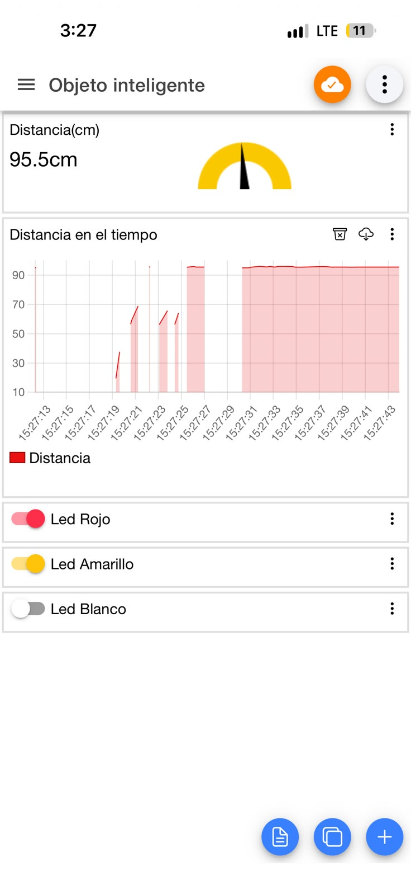
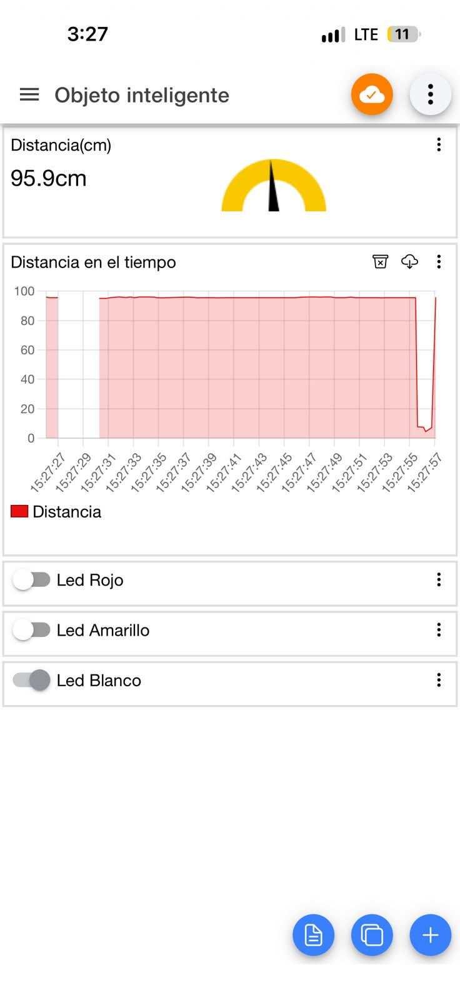

# Panel de IoT MQTT Panel

Configuración del panel de la app móvil [IoT MQTT Panel](https://play.google.com/store/apps/details?id=snr.lab.iotmqttpanel.prod) (Android e iOS). La app es un cliente MQTT más: lee la distancia y publica comandos en los mismos tópicos que el servidor MCP, sin hablar nunca directamente con el ESP32.

La exportación del panel está en [`iot_mqtt_panel_dashboard.json`](iot_mqtt_panel_dashboard.json) y se importa desde el menú de la app (*Import / Restore*). La app exporta la conexión con el broker y el client ID vacíos, así que después de importar hay que completarlos en la conexión con los valores de la tabla siguiente.

## Conexión

| Campo | Valor |
|---|---|
| Broker | `broker.hivemq.com` |
| Puerto | `1883` (TCP, sin TLS) |
| Usuario / contraseña | vacíos (broker público) |
| Client ID | `sis234-g1-app` (único: si otro cliente usa el mismo ID, el broker desconecta al anterior) |

## Widgets

| # | Tipo | Nombre | Tópico | Configuración |
|---|---|---|---|---|
| 1 | Gauge | Distancia (cm) | `sis234/grupo1/distance` | JSONPath `$.cm`, rango 0–200, unidad `cm` |
| 2 | Line Graph | Distancia en el tiempo | `sis234/grupo1/distance` | JSONPath `$.cm` |
| 3 | Switch | Led Rojo | `sis234/grupo1/leds/cmd` | ON `{"led":"red","state":"on"}`, OFF `{"led":"red","state":"off"}`, QoS 1, sin retain |
| 4 | Switch | Led Amarillo | `sis234/grupo1/leds/cmd` | ON `{"led":"yellow","state":"on"}`, OFF `{"led":"yellow","state":"off"}`, QoS 1, sin retain |
| 5 | Switch | Led Blanco | `sis234/grupo1/leds/cmd` | ON `{"led":"white","state":"on"}`, OFF `{"led":"white","state":"off"}`, QoS 1, sin retain |

En todos los widgets está marcado *Disable dashboard prefix topic*, para que la app use el tópico tal cual. Los switches dejan vacío *Subscribe Topic*: así escuchan su propio tópico de comandos y también se mueven cuando otro cliente (por ejemplo Claude) manda un comando a ese LED.

Widgets opcionales que se pueden agregar para mostrar el estado real y la conexión:

| Tipo | Tópico | Configuración |
|---|---|---|
| LED Indicator (uno por LED) | `sis234/grupo1/leds/state` | JSONPath `$.red` / `$.yellow` / `$.white`, ON `1`, OFF `0` |
| Node Status | `sis234/grupo1/status` | online `online`, offline `offline` |
| Button Todo ON / Todo OFF | `sis234/grupo1/leds/cmd` | `{"led":"all","state":"on"}` / `{"led":"all","state":"off"}`, QoS 1 |

## Capturas

| LEDs rojo y amarillo encendidos | LEDs apagados |
|---|---|
|  |  |

Los huecos del gráfico son lecturas `null`: el sensor no recibió eco en ese momento y el ESP32 no publicó ningún número.

## Decisiones

- **El estado real de los LEDs lo publica el ESP32.** Un switch solo recuerda el último comando enviado a su LED. El ESP32 publica `leds/state` (retenido) después de aplicar cada comando, venga de la app o de Claude; los LED Indicators opcionales lo muestran.
- **Comandos con QoS 1 y sin retain.** El comando debe llegar al broker, pero no debe quedar guardado: si quedara retenido, el ESP32 lo volvería a ejecutar en cada reconexión.
- **Rango del gauge 0–200 cm.** Es el rango de trabajo de la demo; el sensor llega hasta 400 cm, pero a esa distancia la aguja casi no se movería.
- **Lecturas `null`.** Si el sensor no recibe eco, el ESP32 publica `"cm": null`; el gauge y el gráfico no reciben un número y esa lectura no se dibuja. Nunca se publica un valor falso.
